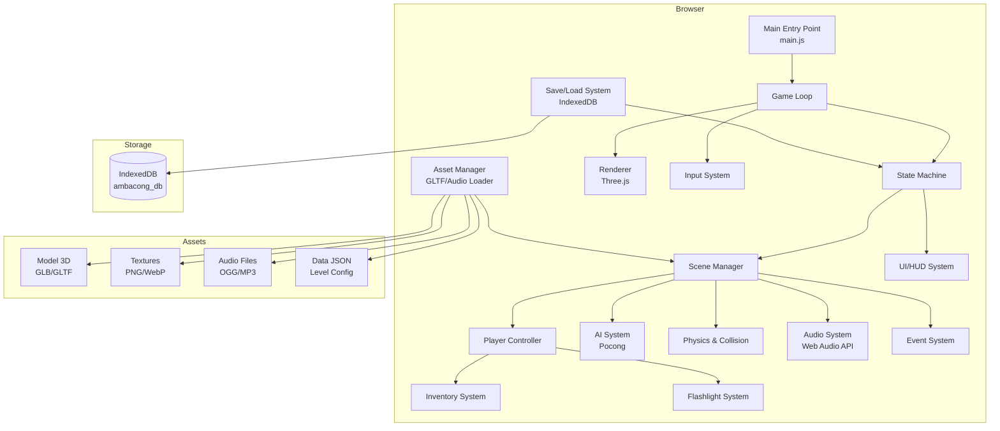
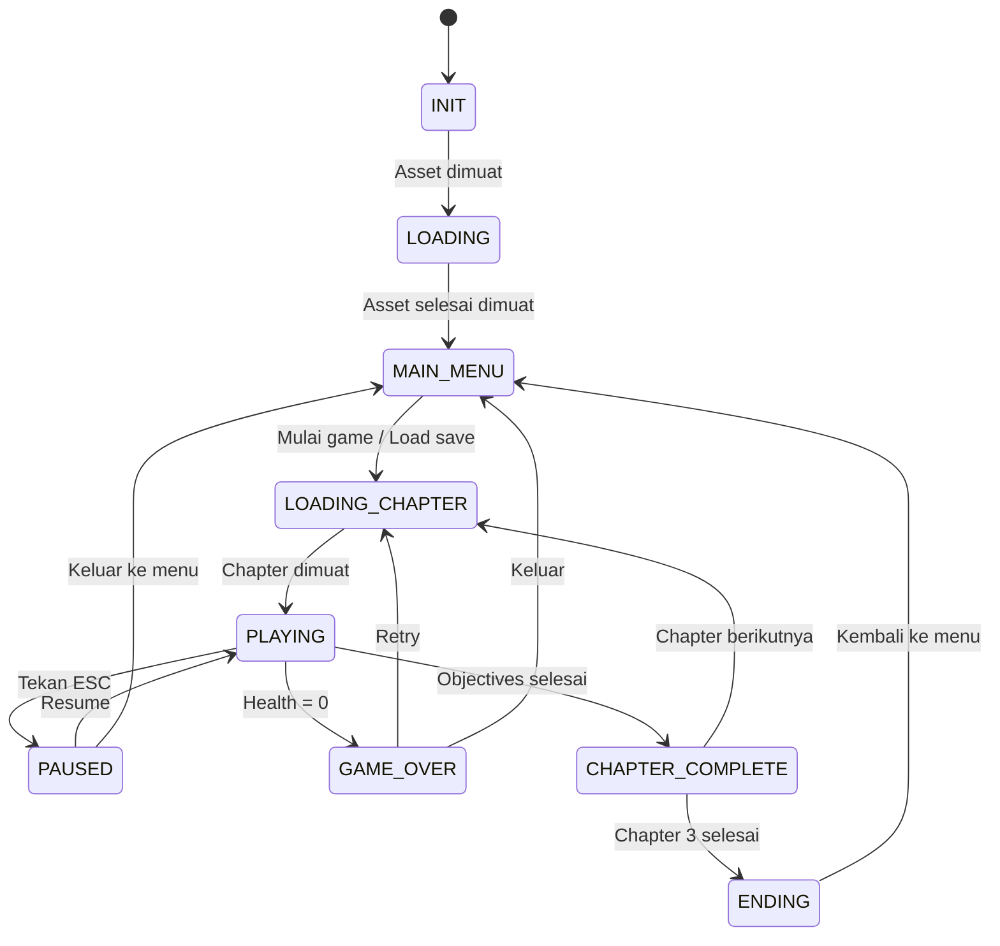
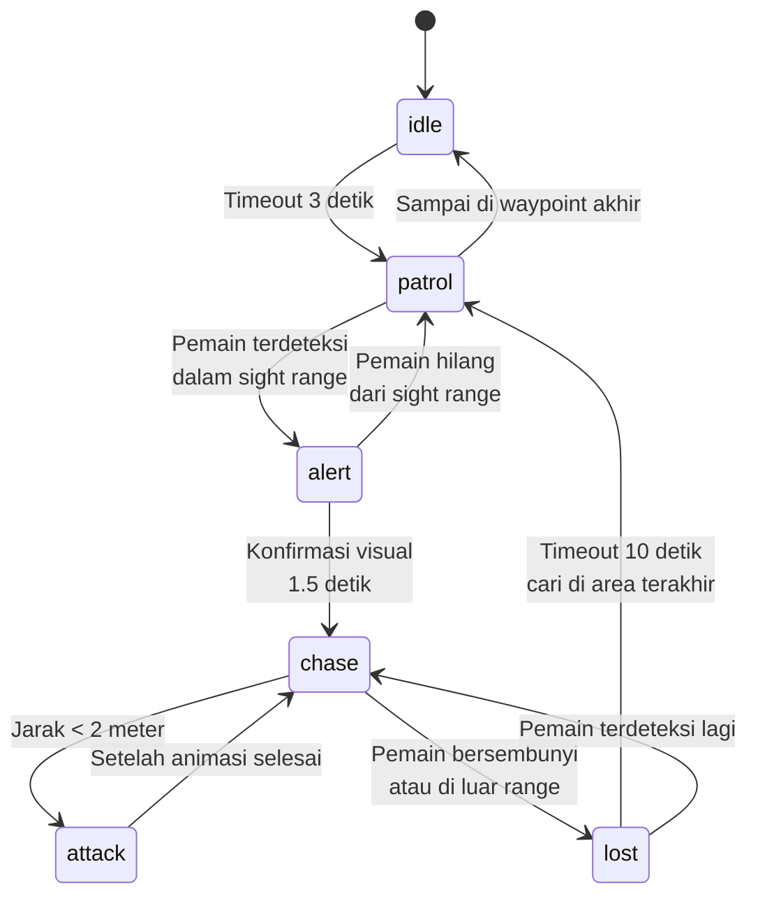
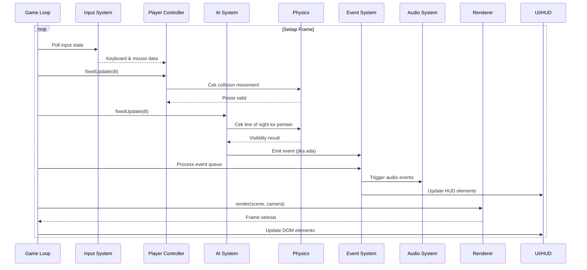

# Arsitektur Teknis - Ambacong

## 1. Gambaran Umum Sistem



## 2. Tech Stack

| Komponen | Teknologi | Alasan |
|----------|-----------|--------|
| 3D Rendering | Three.js | Ringan, komunitas besar, cocok untuk low-poly |
| Bundler | Vite | HMR cepat, native ES Modules, tree-shaking |
| Bahasa | JavaScript (ESNext) | Native browser, no compile step |
| Save System | IndexedDB | Robust, async, capacity besar, structured data |
| Audio | Web Audio API | Spatial audio 3D, low latency, built-in browser |
| Physics | Custom (Raycasting + AABB) | Ringan, cukup untuk kebutuhan horror game |
| UI | Vanilla DOM + CSS | Minimal overhead, full kontrol |

## 3. Sistem Inti

### 3.1 Game Loop & State Machine

Game loop menggunakan `requestAnimationFrame` dengan fixed timestep untuk physics dan variable timestep untuk rendering.



```javascript
// Pseudocode Game Loop
class GameLoop {
  constructor() {
    this.lastTime = 0;
    this.accumulator = 0;
    this.fixedTimeStep = 1 / 60; // 60 updates per detik
  }

  start() {
    requestAnimationFrame(this.loop.bind(this));
  }

  loop(currentTime) {
    const deltaTime = (currentTime - this.lastTime) / 1000;
    this.lastTime = currentTime;
    this.accumulator += deltaTime;

    // Fixed update (physics, AI)
    while (this.accumulator >= this.fixedTimeStep) {
      this.fixedUpdate(this.fixedTimeStep);
      this.accumulator -= this.fixedTimeStep;
    }

    // Variable update (rendering, animation)
    this.update(deltaTime);
    this.render();

    requestAnimationFrame(this.loop.bind(this));
  }
}
```

### 3.2 Scene Manager

Bertanggung jawab memuat dan mengelola scene/chapter. Setiap chapter adalah satu scene Three.js.

**Tanggung jawab:**
- Memuat asset chapter (model, texture, audio)
- Menginisialisasi entitas (player spawn, pocong spawn, item placement)
- Mengelola trigger zones dan event
- Transisi antar chapter (loading screen, fade in/out)
- Dispose resource saat pindah chapter (mencegah memory leak)

### 3.3 Renderer & Kamera (First-Person Controller)

```javascript
// Pseudocode First Person Camera
class FirstPersonCamera {
  constructor(camera) {
    this.camera = camera;
    this.pitch = 0;     // Rotasi atas-bawah
    this.yaw = 0;       // Rotasi kiri-kanan
    this.height = 1.7;  // Tinggi mata (meter)
    this.crouchHeight = 1.0; // Tinggi saat crouch (40% lebih rendah)
    this.headBobAmount = 0.05;
    this.headBobSpeed = 8;
  }

  update(deltaTime, isWalking, isRunning) {
    // Head bob
    if (isWalking || isRunning) {
      const bobMultiplier = isRunning ? 2.0 : 1.0;
      this.camera.position.y += Math.sin(Date.now() * this.headBobSpeed / 1000)
        * this.headBobAmount * bobMultiplier;
    }
  }

  onMouseMove(movementX, movementY, sensitivity) {
    this.yaw -= movementX * sensitivity;
    this.pitch -= movementY * sensitivity;
    this.pitch = Math.max(-Math.PI / 2, Math.min(Math.PI / 2, this.pitch));
  }
}
```

**Konfigurasi renderer:**
- `THREE.WebGLRenderer` dengan `antialias: false` (performa)
- Shadow map: `THREE.PCFSoftShadowMap`
- Tone mapping: `THREE.ACESFilmicToneMapping`
- Pixel ratio: `Math.min(window.devicePixelRatio, 2)` (cap di 2x)
- FOV: 75° default, 60° saat crouch

### 3.4 Fisika & Collision

Menggunakan custom physics ringan berbasis raycasting dan AABB (Axis-Aligned Bounding Box).

**Komponen:**
- **Raycasting**: Deteksi collision pemain dengan dinding/lantai/objek
- **AABB Collision**: Bounding box untuk entitas (pemain, pocong, item)
- **Gravity**: Simulasi gravitasi sederhana untuk pemain
- **Trigger Zones**: Area tak terlihat yang memicu event

**Tidak menggunakan** physics engine penuh (Cannon.js, Ammo.js) untuk menjaga performa ringan.

### 3.5 Audio System

Berbasis Web Audio API dengan kemampuan spatial audio 3D.

**Arsitektur:**
```
AudioContext
├── MasterGain (volume master)
│   ├── MusicGain
│   │   └── BGM Sources
│   ├── SFXGain
│   │   └── SFX Sources (spatial)
│   └── AmbientGain
│       └── Ambient Sources (loop)
└── AudioListener (terhubung ke kamera)
```

**Fitur:**
- **Spatial Audio**: Suara pocong terdengar dari arah dan jarak yang tepat (Panner Node)
- **Ambient layering**: Multiple ambient sound di-layer (angin, jangkrik, dll)
- **Dynamic mixing**: Volume berubah sesuai konteks (chase = music lebih keras)
- **Falloff**: Suara mengecil berdasarkan jarak (linear/exponential)

### 3.6 AI System (Pocong Behavior)

State machine pocong dengan transisi berdasarkan kondisi lingkungan.



**Parameter AI per state:**

| State | Speed (m/s) | Detection Range (m) | Durasi |
|-------|-------------|---------------------|--------|
| `idle` | 0 | 8 | 3 detik |
| `patrol` | 1.5 | 12 | sampai waypoint |
| `alert` | 0 | 15 | 1.5 detik |
| `chase` | 4.0 | 20 | sampai hilang |
| `attack` | 0 | 2 | 1 detik |
| `lost` | 2.0 | 10 | 10 detik |

**Sistem Deteksi:**
- **Sight**: Cone detection (FOV 90°) di depan pocong
- **Sound**: Radius lingkaran. Sprint pemain = radius besar, crouch = radius kecil
- **Flashlight**: Jika senter diarahkan ke pocong, detection range meningkat 50%

**Navigasi MVP:**
- Map menyimpan waypoint graph statis yang mengikuti lorong dan pintu.
- Patrol mengikuti rute waypoint yang sudah ditentukan.
- Chase memakai A* menuju waypoint terdekat dari posisi terakhir pemain.
- Path dihitung ulang hanya saat target waypoint berubah atau jalur terputus.
- Navmesh dan physics engine penuh tidak digunakan pada vertical slice.

**Hiding:**
- Interaksi dengan `hiding_spot` menandai pemain sebagai hidden.
- Pemain hidden tidak dapat dideteksi sight atau sound.
- Pocong yang sedang mengejar masuk state `lost`, menuju posisi terakhir pemain, lalu kembali patrol.

### 3.7 Input System

Menangani keyboard, mouse, dan Pointer Lock API.

**Keybinding default:**

| Tombol | Aksi |
|--------|------|
| W/A/S/D | Gerak maju/kiri/mundur/kanan |
| Shift (tahan) | Sprint |
| Ctrl (tahan) | Crouch |
| E | Interaksi |
| F | Senter on/off |
| Tab | Buka/tutup inventory |
| ESC | Pause menu |
| Mouse Move | Arahkan pandangan |
| Mouse Click | Gunakan item / Interaksi |

### 3.8 UI/HUD System

UI dirender menggunakan HTML/CSS overlay di atas canvas Three.js.

**Komponen HUD (in-game):**
- Health bar (kiri bawah)
- Stamina bar (di bawah health)
- Flashlight battery indicator (kanan bawah)
- Crosshair (tengah)
- Interaction prompt (tengah bawah)
- Inventory grid (bawah tengah, toggle dengan Tab)

**Menu screens:**
- Main Menu (New Game, Continue, Load, Settings, Credits)
- Pause Menu (Resume, Save, Settings, Quit)
- Loading Screen (progress bar, tips)
- Game Over Screen (Retry, Main Menu)
- Chapter Complete Screen (stats, next chapter)

### 3.9 Save/Load System (IndexedDB)

**Database**: `ambacong_db`

**Object Stores:**

| Store | Key | Deskripsi |
|-------|-----|-----------|
| `saves` | `slot` (1-3) | Data save game |
| `settings` | `config` | Pengaturan pemain |

Object store achievement ditunda sampai fitur masuk scope rilis.

**Operasi:**
- `saveGame(slot)` — Simpan GameState saat ini ke slot tertentu
- `loadGame(slot)` — Muat GameState dari slot tertentu
- `deleteSave(slot)` — Hapus save di slot tertentu
- `saveSettings(config)` — Simpan pengaturan
- `loadSettings()` — Muat pengaturan
- Auto-save saat masuk chapter baru
- Validasi `schemaVersion` sebelum load; migrasikan versi lama atau tampilkan pesan save tidak didukung

### 3.10 Asset Manager

Mengelola loading dan caching semua asset game.

**Loader yang digunakan:**
- `THREE.GLTFLoader` — untuk model 3D (.glb/.gltf)
- `THREE.TextureLoader` — untuk texture (.png/.webp)
- `AudioContext.decodeAudioData()` — untuk audio (.ogg/.mp3)
- `fetch()` — untuk data JSON (level config, item data)

**Fitur:**
- Loading queue dengan progress callback
- Asset caching (tidak load ulang asset yang sama)
- Preload asset chapter berikutnya saat bermain
- Dispose asset chapter sebelumnya saat pindah

### 3.11 Event System

Pub/sub event system untuk komunikasi antar sistem tanpa coupling langsung.

```javascript
// Penggunaan
eventBus.on('player-died', () => {
  stateManager.setState('GAME_OVER');
  audioSystem.play('sfx-game-over');
});

eventBus.emit('player-died', { chapter: 2, cause: 'pocong-attack' });
```

**Event penting:**

| Event | Trigger | Listener |
|-------|---------|----------|
| `player-died` | Health = 0 | State Machine, Audio, UI |
| `item-collected` | Pemain ambil item | Inventory, Audio, UI |
| `pocong-detected` | Pocong lihat pemain | AI, Audio, UI |
| `chapter-loaded` | Scene selesai load | All Systems |
| `jumpscare` | Trigger zone | Audio, UI, Camera |
| `door-unlocked` | Item kunci digunakan | Scene, Audio |
| `save-completed` | Save berhasil | UI (notification) |
| `flashlight-empty` | Battery = 0 | Flashlight, Audio, UI |

## 4. Alur Data - Game Loop Sequence



## 5. Dependency Graph Antar Modul

```
main.js
├── core/game-loop.js
│   ├── core/state-machine.js
│   └── core/event-bus.js
├── core/input-system.js
├── scenes/scene-manager.js
│   ├── entities/player.js
│   │   ├── systems/flashlight.js
│   │   └── systems/inventory-system.js
│   ├── entities/pocong.js
│   │   └── systems/ai-system.js
│   ├── entities/interactable.js
│   └── systems/physics.js
├── systems/renderer.js
├── systems/audio-system.js
├── systems/save-system.js
├── ui/hud.js
├── ui/menu.js
└── ui/loading-screen.js
```

## 6. Build & Development

### Development
```bash
npm ci             # Install dependencies dari package-lock.json
npm run dev        # Start Vite dev server (HMR enabled)
```

### Production Build
```bash
npm run build      # Build ke dist/
npm run preview    # Preview production build
```

### Vite Config
```javascript
// vite.config.js
import { defineConfig } from 'vite';
import { fileURLToPath, URL } from 'node:url';

export default defineConfig({
  resolve: {
    alias: {
      '@': fileURLToPath(new URL('./src', import.meta.url)),
    },
  },
  server: {
    port: 3000,
    open: true,
  },
});
```
